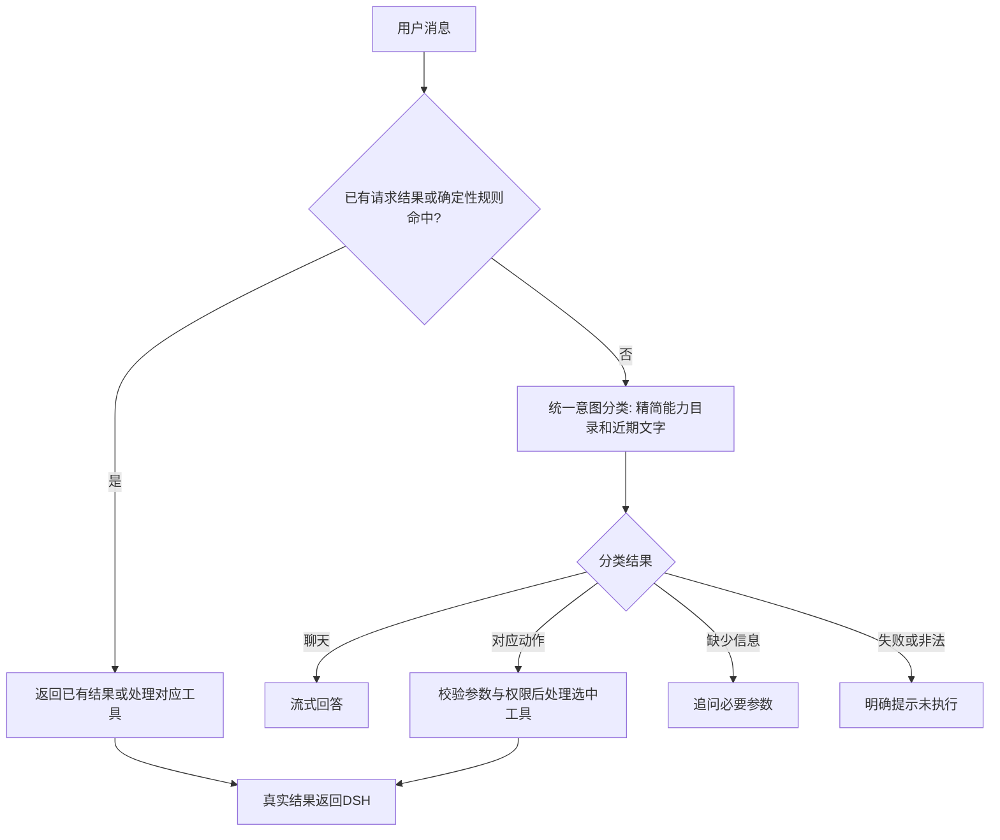

# 架构与能力扩展

## 模块职责

- `settings.py`：配置文件、环境覆盖、路径解析。
- `context.py`：线程与协程隔离的 session/request/user_text。
- `capabilities.py`：能力描述、相关工具组筛选，保留 DSH 原生工具。
- `router.py`：确定性规则、未命中统一语义兜底、参数校验与请求去重。
- `intent.py`：精简能力目录、有限近期文字、受限分类结果校验；显式区分聊天、任务、澄清与分类失败。
- `message_service.py`：确认词检查、原子领取、执行结果持久化。
- `store.py`：SQLite 事务，保存消息、联系人选择/时间追问、请求缓存、会话指纹连续性和提醒。
- `reminder_delivery.py`：分别投递 QQ 与桌宠，租约防止多调度器同时领取。
- `kvmem_proxy.py`：OpenAI 兼容入口、能力路由与 SSE 转发。
- `dsh_watch.py`：只读 DSH 会话适配器，不拥有工具执行权。
- `dsh_history.py`：读取DSH v4完整日志及本轮完成标记，跳过摘要和思考内容。
- `reply_policy.py`：向每次模型请求加入当前篇幅与能力真实性要求，兼容旧会话。
- `presentation.py`：有界队列、合成预取、顺序播放、进程内任务去重与状态。
- `game_routes.py`、`games/sillytavern.py`：独立酒馆接口、短期令牌与租约、剧情版本、笔记、接管轮数和一次性提交凭据；不调用现实工具。
- `game_context.py`：为意图与回答固定同一剧情版本，跨开麦和DSH注入共享资料；关闭和过期后停止新观察，只能回顾标记为非实时的近期历史。
- `game_memory.py`：本机SQLite共享会话，记录剧情版本、最后同步时间及有界场外交流；并发写入、换聊天、改历史和清除时隔离旧结果，不授予工具或接管权限。
- `persona.py`：从当前桌宠角色提取性格与说话习惯，供陪玩点评和问答共用，剥离工具协议与现实操作指令；玩家行动使用独立Persona。
- `sillytavern-extension/`：酒馆端读取可见聊天、独立草稿、单轮与有限接管；输入与剧情变化立即归还控制权。

不需要拆成微服务。多个入口共享同一个数据目录时使用同一数据库；多个独立安装可分别设置 PET_CONFIG/PET_DATA_DIR。

## 添加一项能力

1. 在 `capabilities.REGISTRY` 注册能力名称、描述、相关词和工具名称。
2. 在 `tools.py` 实现工具，返回真实执行结果。外部副作用应有独立状态和固定动作 ID。
3. 在 `router.ARGUMENTS` 声明参数白名单；如需非字符串参数，显式增加类型校验。
4. 需要快速句式时，在 `router.parse` 添加规则；没有规则时，所有用户消息统一语义分类。模型参数白名单也需在 `intent.ARGUMENTS` 声明，不需要添加候选触发词才允许分类。
5. 在 `server.py` 注册 MCP 工具，或通过统一 route_command 调用。
6. 添加正常、歧义、重试、失败和会话隔离测试。

未命中规则的普通聊天也先分类。分类器不执行工具，不具备确认发送权限；确认必须匹配本轮原始用户文字。分类失败不进入自由聊天。`capabilities`中的词表只供显式兼容模式筛选工具，不再作为是否调用分类器的门槛。



## 消息状态

```text
pending → sending → sent / failed / unknown / dry_run
pending → cancelled
```

领取 pending 使用 BEGIN IMMEDIATE。网络请求在事务外进行，领取后崩溃不会自动再发；sending 或 unknown 必须先核对外部状态。失败内容保留，重新提出请求可再次准备。准备新的消息会取消同会话原来的 pending。

发送成功的事实来自协议返回与消息状态，不再用“最近几分钟出现过某个工具日志”判断。聊天模型的文字不能作为执行证据。

## 提醒状态

同一提醒有独立的 QQ、语音入队状态。明确未成功的通道稍后重试；未知通道保留供核对，不盲目重发。语音通道 sent 只表示队列接收，实际播放结果通过 speech/status 查询。已领取提醒的取消请求会告知正在投递。

## 发布源

本地开发可使用 `scripts/sync_sources.py --pet <桌宠目录>` 将桥接代码、七个定制后端文件和清单内的客户端源文件复制到发布树。同步不读取 config.json、账号、状态、日志和模型资源；sync.ps1 不会自动提交或推送。客户端覆盖和重建见 vision.md。

安装器限制 Open-LLM-VTuber 1.2.1，避免把覆盖文件静默安装到不兼容版本。修改覆盖范围时要更新 RUNTIME_FILES、测试和 README。上游升级需要独立适配，不建议直接追踪 main。
