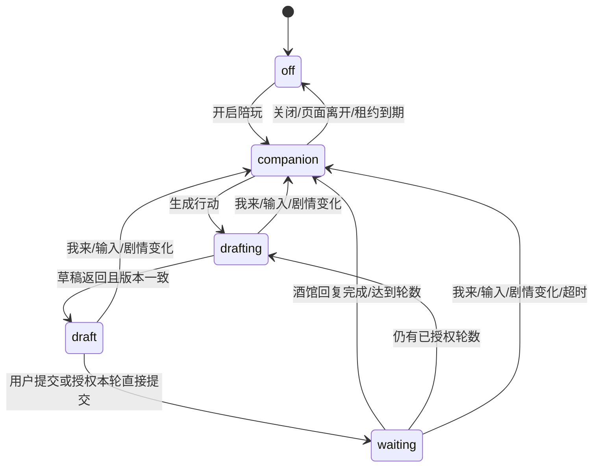

# 大肥鱼酒馆接入设计

## 范围与实现顺序

1. 独立游戏接口：来源检查、临时配对、30秒租约、关闭默认值、当前聊天及版本校验。
2. 陪玩：读取当前可见正文，点评、问答、可选桌宠播报；不写入剧情。
3. 单轮接管：生成可编辑草稿，提交前再核对聊天、消息、输入框与授权。
4. 有限连续接管：用户选择1至5轮，逐轮等待酒馆完整回复；输入、停止、换聊天或改剧情就暂停。
5. 离线回归、模拟浏览器、独立酒馆数据目录的端到端测试；通过后才安装到实际酒馆。

## 数据与权限

- 默认关闭，页面重载后不恢复操作授权。一个桌宠服务同一时间只接受一个活跃酒馆页。
- 扩展通过getContext读取当前可见聊天正文、发言者、玩家公开Persona；不读取角色卡、世界书、系统提示或密钥。
- 所有原始可见消息计算指纹，传递完整历史指纹和最近的有限正文。正文预算有上限；删改已覆盖剧情则作废旧笔记和草稿。
- 扩展以当前酒馆Origin配对，服务仅接受配置允许的本机Origin。会话令牌只保存在页面内存，不能调用QQ、提醒或屏幕接口。
- 游戏内容始终作为资料传给独立模型调用；游戏模块不导入命令路由或现实工具，不向模型提供工具。
- 只在活跃租约内共享剧情；关闭或失联后不再向桌宠提供新上下文。记忆以聊天标识分别保存，可单独清除。

## 状态与回合

- 关闭、暂停和版本变化先提升会话世代号，取消未结束任务；旧结果不能重新启用或提交。
- 草稿与聊天版本绑定，服务器提交凭据一次性领取；扩展提交前再次检查版本和输入框。网络错误不自动重发。
- 连续接管只在自己提交的玩家回合确实收到新的NPC完整回复后继续。每轮只提交一次，最多5轮，等待超时后暂停。
- 手动输入不覆盖；已进入酒馆生成的回合不删除，暂停阻止下一轮。

## 模型、记忆与语音

- 游戏模型直连配置的KVMem上游，不经过现实命令网关。
- 场外点评使用大肥鱼人格，玩家行动使用当前玩家Persona，两种输出分开。
- 点评冷却及去重；背景点评遇到模型繁忙或正在正常聊天时跳过。问答与行动由用户显式请求。
- 剧情笔记仅总结已提供的可见信息，区分事实与怀疑；定期随点评更新，旧历史变化时清除重建。
- 语音复用现有有界队列，游戏任务带有效性检查，过期待播内容丢弃，不取消普通聊天/提醒的语音。
- 开启陪玩时，网关可读取本机租约内的游戏上下文，作为资料补充给大肥鱼；关闭时原有请求不变。

## 验收

- 关闭不读剧情、不请求游戏模型、不提交行动；重载后仍关闭。
- 陪玩模式不能提交行动；单轮只提交一条；连续达到指定轮数立即停止。
- 输入、聊天切换、编辑、删除、swipe、取消及迟到结果均不能造成错误提交。
- 故事内QQ/提醒命令不会调用现实工具；异常来源和失效令牌被拒绝。
- 现有QQ确认、意图分类、流式聊天、视觉授权、TTS及安装回归继续通过。
- 完整测试使用独立数据目录，不改动用户角色卡、聊天或API配置，不向真实联系人发送测试消息。
